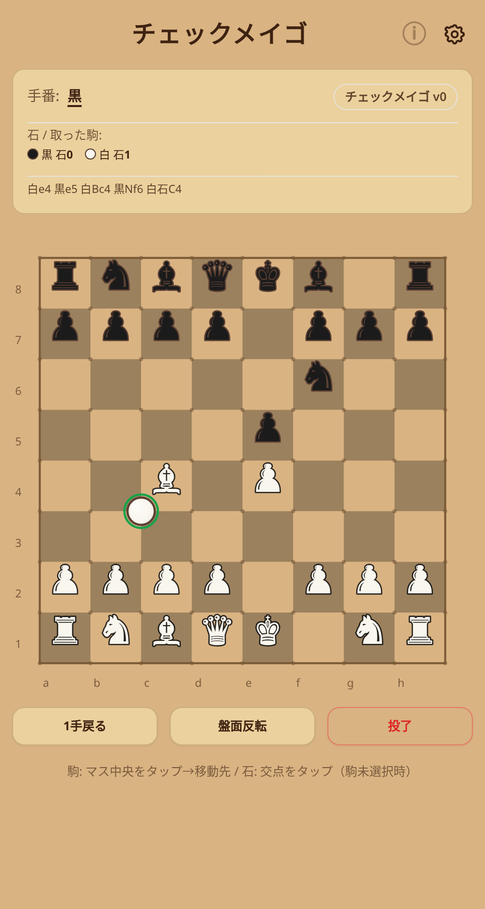
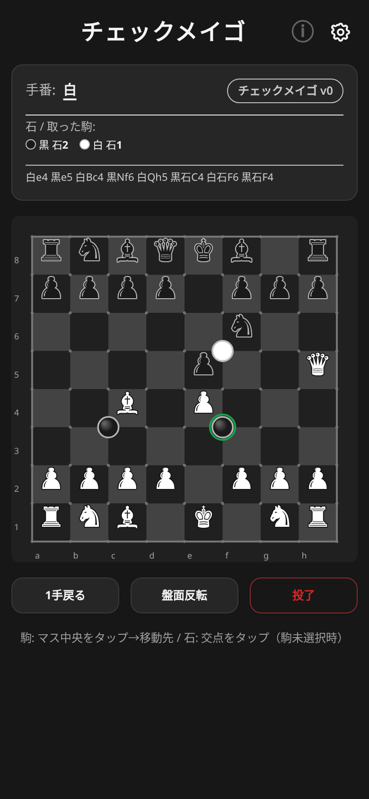
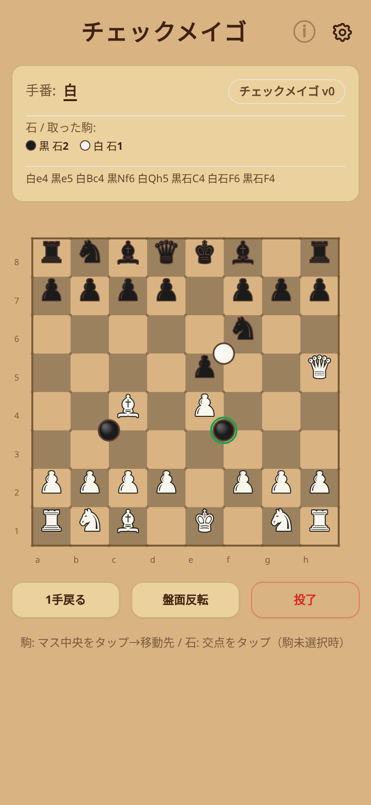
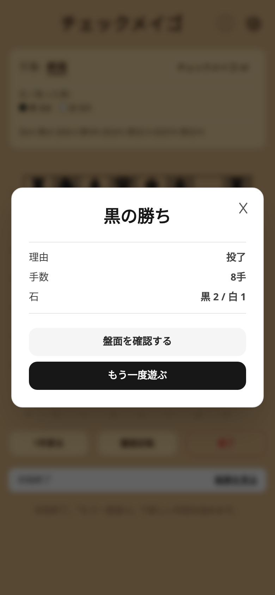

# チェックメイゴ CHECKMEIGO

チェスと囲碁を1枚の盤に重ねた混合ゲーム **v0** です。マスの中央にチェスの駒、交点（9×9）に碁石を置きます。同一端末での2人対戦、AIなし。

**公開URL:** https://sas-news.github.io/checkmeigo/

## ルール（v0）

1. **手番と行動** — 白が先手。1手につき「駒を1つ動かす」か「交点に石を1つ置く」のどちらか。
2. **駒（チェス）** — 駒の動き・取り方・チェック・チェックメイト、キャスリング、アンパッサン、プロモーション（選択式）は通常のチェス通り。**王手されているときは石を置けず、駒で受けます。**
3. **石（囲碁）** — 石はマス目の交点（9×9）に置きます。上下左右の呼吸点がすべて無くなった連は取り上げられます。自殺手と、同一局面を繰り返す手は禁止。
4. **勝敗** — チェックメイトで勝ち。投了あり。50手ルール・駒不足・ステイルメイト（駒も石も打てない）は引き分け。
5. **未定のまま残していること** — 石が駒の動きに干渉するか、石による得点・終局条件、王手と石の相互作用など。v0 では駒と石の層を独立させ、**行動だけを共有**しています。

## 操作

- **駒**: マス中央をタップ → 移動先をタップ（緑=移動、赤=取り）。デスクトップは交点上でホバーすると石のプレビューが出ます。
- **石**: 交点（マスの角）をタップ（駒を選択していないとき）。
- **1手戻る / 盤面反転 / 投了**（投了は2タップ確認）、テーマ切替、効果音、sessionStorage による局面の自動保存。

## デザインシステムの流用元

GUI の基礎は [cerevisiae-fii/hexago](https://github.com/sas-news/hexago) から**デザインシステムだけ**を流用しています。

- 流用したもの: Tailwind CSS 土台、CSS 変数テーマ（`--bg` / `--tx` / `--card` / `--bd`）、`.card` / `.btn` / `.opt` / `.dot`、ヘッダ＋設定・ルールボタン、手番カード、canvas、操作ボタン列、結果バナー、undo・設定・ルール・結果モーダル、テーマ切替、効果音、sessionStorage 保存
- 削除したもの: PeerJS オンライン対戦一式、六角盤ジオメトリ、MCTS、2〜6人の可変人数、AI 席切替、ベンチ・E2E・WASM
- 差し替えたもの: 中央のゲーム盤。チェスのマス（8×8）と囲碁の交点（9×9）を同じ盤に重ね、駒はマス中央、石は交点に描画

## 起動

```bash
python3 -m http.server 8000
# http://localhost:8000/index.html
```

`index.html` 1枚で動く静的アプリです（Tailwind は CDN 読み込み）。GitHub Pages にそのまま置けます。

## 開発・テスト

```bash
node dev/selftest.js        # エンジンの自己テスト（チェスの perft・囲碁ルール）
node dev/smoke-cdp.js       # ブラウザE2E（要 HTTP サーバーと chrome-headless-shell）
node dev/screenshots.js     # テーマ別スクリーンショット撮影（目視確認用）
```

`dev/selftest.js` は `index.html` 内の `/*ENGINE-START*/ … /*ENGINE-END*/` 区間を抽出して Node で実行します。チェスは perft（初期局面 depth 3 = 8902、Kiwipete depth 2 = 2039）まで検証しています。

E2E の前提:

```bash
python3 -m http.server 8123 --bind 127.0.0.1 &
chrome-headless-shell --headless --no-sandbox --remote-debugging-port=9222 about:blank &
node dev/smoke-cdp.js
# 本番確認: APP_URL=https://sas-news.github.io/checkmeigo/ node dev/smoke-cdp.js
```

## 構成

```
index.html            アプリ本体（HTML/CSS/JS 1ファイル）
dev/selftest.js       エンジン自己テスト（DOM非依存）
dev/smoke-cdp.js      CDP によるブラウザE2E
dev/screenshots.js    テーマ別スクリーンショット撮影
artifacts/            スクリーンショット（E2E・テーマ確認）
```

## スクリーンショット

| 既定テーマ | ダークテーマ |
| --- | --- |
|  |  |

| 和風テーマ | 結果 |
| --- | --- |
|  |  |

## 意図的に決めていないこと

- 石と駒の干渉（移動の妨害・取り合いなど）
- 石による得点・終局条件、王手と石の相互作用
- 持ち時間・時計
- 盤サイズ・コミ・オンライン対戦
